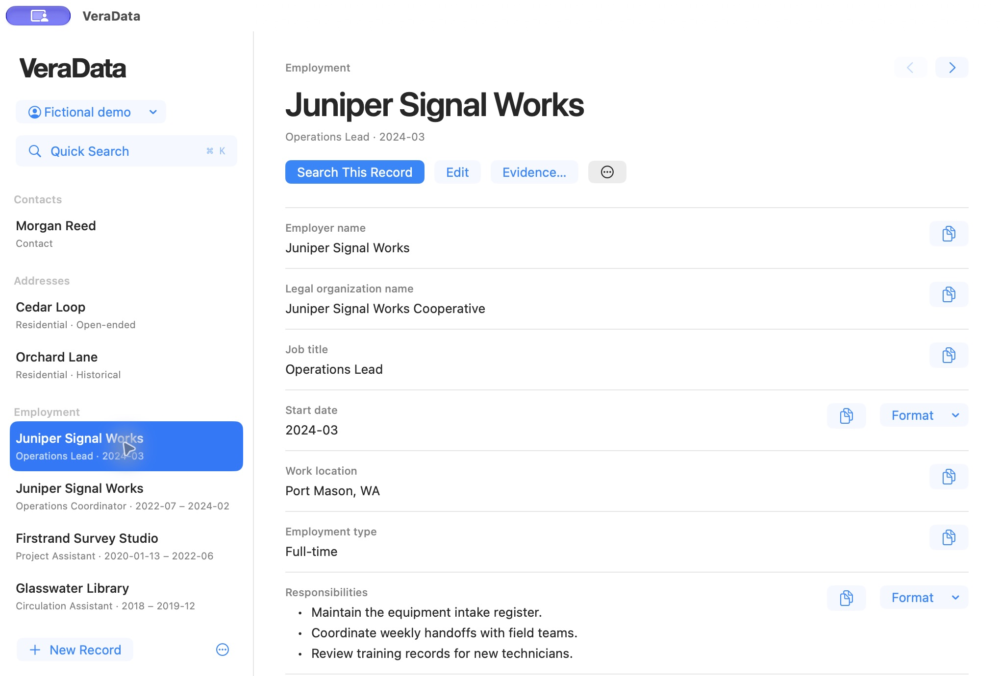

# VeraData

VeraData is a local-first macOS utility for keeping reusable information close at hand. Save a phone number, address, or employment record once, then find and copy the detail a form asks for. A job can stay selected while you look up its start date, title, and responsibilities.



## Try it

Build on macOS 14 or later with Swift 6 and the macOS SDK. The build has no third-party dependencies.

```sh
./scripts/build-app.sh
open dist/VeraData.app
```

This creates an ad-hoc-signed app for local use. Leave VeraData running to use its global shortcut.

To install it in **Applications**, quit VeraData and run `./scripts/install-app.sh` after building. The script moves the new app into place and keeps the previous build if one exists.

When a newer stable version is available, **Update App…** appears in the sidebar and in the **VeraData** menu. Either button opens that version on GitHub. Get the newer source, then run the build and install steps again.

1. Click **Open Fictional Demo**. In another app, press **⌃⌥Space**, type `phone`, press **Return**, and paste with **⌘V**. The expected value is `+1 (202) 555-0142`.
2. Open Quick Search again. Search for `Juniper` and press **Return** on one of the company’s two roles. The role and dates appear at the top of the palette.
3. Search for `start year` and press **Return**. Operations Lead gives `2024` and Operations Coordinator gives `2022`. Use the arrows in the palette to switch roles or **Search All** to clear the scope.
4. Use the profile menu to switch back to **Personal** and add your own records.

You can also invoke search with **⌘K** inside VeraData. If the global shortcut conflicts with another app, choose an alternative in **Records › Global Search Shortcut**.

## Save and back up a vault

VeraData saves edits automatically. Choose **File › Save Vault As…** to create a complete working copy that includes all profiles, evidence originals and marks, export presets, settings, and revision history. Future edits go to the new vault. You can reopen the original or another copy with **File › Open Vault…**.

- **Unencrypted** creates a `.veradatavault` file with no vault password. Anyone who can read the file can access its contents.
- **Password-protected** creates an encrypted `.veradata` file. Keep its password somewhere safe. Use **File › Lock Vault** to clear an open password-protected vault from the app. VeraData cannot recover its password.
- **Back Up Records as JSON…** creates a readable copy of all profiles, records, and the global search shortcut. Evidence files and marks, export presets, and revision history are excluded. Use **File › Import Records…** to recover selected records, or **Restore Records from JSON…** to replace the records in an unencrypted vault.

Either complete vault format can be saved in iCloud Drive. Work on one device at a time and let syncing finish before switching devices. VeraData rejects stale saves and blocks writes when macOS reports an unresolved conflict. Keep both files if the provider creates a conflict copy.

## Everyday use

- **Store details.** Contact, address, employment, and education editors provide suggested fields. Add a custom field for anything else. The field state distinguishes omitted, unknown, and present values. If you enter a month or year only, VeraData preserves that precision.
- **Find a field.** Search by employer, job title, field name, or familiar names such as `phone` and `job duties`. Under **Search Shortcuts** in the editor, you can add exact aliases such as `;ph`.
- **Work through several jobs.** **Search This Record** pins a job in Quick Search. The palette remembers its scope until you switch records or choose **Search All**. In the main window, use **⌘[** and **⌘]** to step through records of the same type.
- **Choose a format.** The **Format** menu offers available date components, phone digits, and plain text for lists. Lists display and copy with bullets by default. The phone options remove punctuation without inferring a dialing country. For an international mailing address, enter the complete address in **Mailing lines** using the destination’s spelling and line order. The automatic summary uses a U.S.-style order.
- **Copy today or now.** In Quick Search, type `today` for the date on your Mac or `timestamp` for the current local time with a UTC offset. The **Format** menu also offers a localized date, UTC time, and Unix seconds where applicable.
- **Find saved coordinates.** In an address editor, choose **Add Coordinates** and enter decimal latitude and longitude. Search for the address name and `coordinates` to copy the pair for a map or form.
- **Keep address history.** Add a new address record when you move. Enter the previous address’s **Through** date so it appears as historical. Address use and date history are stored independently.
- **Share selected data.** Choose **File › Export Data** to select fields and individual list items across the active profile. Arrange the records, then review the exact JSON before saving. Use a record’s **Export Selected Fields** command for the original single-record flat JSON format.
- **Recover an earlier version.** Choose **File › Revision History** to inspect and restore earlier records and presets. History can retain deleted data.

### Reuse address fields in Mailing lines

Enter mailing text as written, or reference fields from the same address with stable keys such as `{{line1}}`. Arrange the lines in the destination’s preferred order.

```text
{{recipient}}
{{streetAddress}}
{{unit}}
{{city}}, {{region}} {{postalCode}}
{{country}}
```

Fill **Recipient name** with the person or organization that should receive the mail. `{{name}}` also works. `{{streetAddress}}` uses **Street address**, and `{{unit}}` or `{{unitNumber}}` uses **Unit or apartment**. The keys `{{line1}}` and `{{line2}}` also work.

Lines whose placeholders are all empty are skipped. The Mac record view lists which fields were skipped below the address. The app displays and copies the rendered address, and the **Format** menu offers **As stored** for the template. JSON exports keep the template as entered so selecting **Mailing lines** does not implicitly include unselected fields.

## Check fields against evidence

Open a record and choose **Evidence… → Attach PDF or Image…**. Draw one box around the supporting passage, check the fields it actually shows, then choose **Mark as Checked**. For an address block, **Select Address Fields** selects populated street, unit, city, region, and postal code fields together. Add country or mailing lines individually if the document shows them. A later edit to one field makes that field **Needs review**. Reopen the mark to compare it again.

VeraData keeps a private copy of the source. **Save Vault As…** includes the original files and their marks in either format. Résumé, structured, flat, and JSON record backups exclude evidence. The Mac app can include explicitly chosen evidence in an iPhone transfer. [Evidence storage and recovery](docs/architecture.md#field-evidence)

## Import records

Choose **File › Import Records** to preview JSON and add or selectively update records in an existing or new profile. The importer accepts VeraData backups, iPhone transfers, structured selections, and plain JSON objects. Other tools can create an import file using the [example](examples/record-import.json).

Select the destination profile before reviewing. Possible matches start as **Skip**. To update one, choose the existing record and check the individual fields you want to change. When a backup contains several profiles, import each desired source profile separately.

For an ongoing job, enter **Present** as the employment end date. Dates still accept year, year–month, or full-date precision.

## Build a résumé in VeraFlow

1. In VeraData, choose **File › Export Data**, then **Résumé data (JSON)**.
2. Open **Select Résumé Fields** and choose **Standard** for contact, employment, and education, **Recommended** to add recognized skills, projects, languages, and certifications, or **Select All** to review every résumé-eligible field. Select one contact first if your profile contains several. Assign an unclassified custom record to a résumé section or exclude it before reviewing. Use **Select All Fields** for one record, uncheck individual bullets, and use the arrows to set record order. A selected `title` field becomes a project heading.
3. Choose **Review** to check the exact JSON, then save it.
4. In VeraFlow Desktop, choose **Open JSON / JSON5**, open the export, and use `../veraflow/examples/source/resume-pdf.vf` from the neighboring checkout. Prepare the output, then select **Save as PDF…** on macOS to review the Markdown and convert locally with Pandoc and XeLaTeX. [Canonical résumé form](https://github.com/iandorsey00/veraflow/blob/main/examples/source/resume-pdf.vf)

Keep internal notes and employer verification details in separate fields. Bulk résumé selection includes every bullet in eligible lists, so review those lists before saving your preset.

For other workflows, choose **Structured JSON**. It preserves selected lists, objects, and scalar types without requiring VeraFlow. [Export formats](docs/specification.md#selective-projection)

### Run from the terminal

In VeraData, review your export and choose **Save Preset…**. Name it `resume`. If you also choose **Save JSON…** for that selection, VeraData suggests `resume.json` in the save dialog. Install the [VeraFlow CLI and PDF dependencies](https://github.com/iandorsey00/veraflow/blob/main/examples/source/pdf-demo.md) once.

Open the built app at `dist/VeraData.app` to save the preset. From the VeraData checkout, with VeraFlow in the neighboring checkout, run:

```sh
./scripts/veradata export --preset resume |
  ../veraflow/scripts/veraflow pdf - \
    ../veraflow/examples/source/resume-pdf.vf --output Resume.pdf
```

A whole-field selection follows the current scalar, list, or object. If a preset uses individual list items and VeraData can no longer match them safely, review the selection and update the preset. For other VeraFlow templates, use **Single-record JSON** from the record’s export menu to choose a flat set of fields. For Markdown on stdout, use VeraFlow’s `render` command and omit `--output`.

To save the same selected records as structured data with original field values and lists, use:

```sh
./scripts/veradata export --preset resume --format structured > Resume-data.json
```

For another person, switch to their profile, review their data, and save a distinct preset such as `second-resume`. Run the same pipeline with `--preset second-resume` and a different PDF filename.

The VeraData CLI uses the desktop app’s vault by default. Preset names are case-insensitive. You can also create and edit profiles and records, preview imports, manage presets, or export an iPhone transfer entirely from the terminal. See the [command-line guide](docs/cli.md) for a fictional walkthrough and examples. Presets live beside the vault and are backed up separately. For related changes, use `veradata apply FILE` to preview the batch, then apply it with its preview token. VeraData saves automatic recovery revisions for both desktop and CLI edits. [Changelog](CHANGELOG.md)

## VeraData on iPhone

The read-only companion lives in this repository and shares the Mac app’s validation, search, and field formatting. It requires iOS 17 or later. To build locally, open [iOS/VeraData.xcodeproj](iOS/VeraData.xcodeproj) in the full Xcode app and select the **VeraDataPhone** scheme. Choose a simulator, or choose a signing team and your iPhone for a device build.

1. On Mac, choose **File › Export for iPhone** and check the records you want. To carry evidence, check individual documents or choose **Select All Evidence for Checked Records**. The transfer contains the full original PDFs or images, including areas outside a mark.
2. Transfer the JSON file to your iPhone and select it under **Import Transfer**. Future imports replace the downloaded snapshot after confirmation.
3. Open a record, and tap a document in **Evidence** to view its marked page. Pinch to zoom. Search and copy fields as usual.

The interface follows the app’s system language in English or Simplified Chinese. Record contents stay in the language you entered. Imported records are available offline.

### iPhone 使用方式

在 Mac 上选择 **文件 › 导出到 iPhone**，勾选要携带的记录。将 JSON 文件传到 iPhone 后，在 VeraData 中选择 **导入传输文件**。导入后可离线搜索并复制字段。界面支持英语和简体中文，已保存的内容保留原文。可逐个选择证据文件，或点击 **全选所选记录的证据**。在 iPhone 上打开记录，在 **证据** 下点按文件可查看原始 PDF 或图像的标记区域。

## Development

```sh
./scripts/test.sh
./scripts/build-app.sh
python3 scripts/check-cli.py ./scripts/veradata
```

See the [data specification](docs/specification.md), [JSON Schema](schema/vault-v1.schema.json), [fictional example](Sources/VeraDataApp/Resources/demo.json), and [architecture, privacy, and recovery guide](docs/architecture.md).

Browser autofill is future work. Licensed under [MIT](LICENSE).
